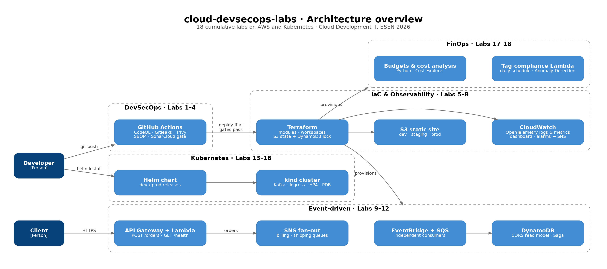

# cloud-devsecops-labs

> 18 progressive labs on AWS: a secure CI/CD pipeline, Infrastructure as Code, event-driven architecture, Kubernetes and FinOps, built on one evolving codebase.


---

## Table of contents
- [Overview](#overview)
- [Architecture](#architecture)
- [Labs](#labs)
- [Technical highlights](#technical-highlights)
- [Tech stack](#tech-stack)
- [Repository layout](#repository-layout)
- [Browse by lab](#browse-by-lab)
- [Getting started](#getting-started)
- [Cost & cleanup](#cost--cleanup)
- [Practices applied](#practices-applied)
- [Related project](#related-project)
- [Team & author](#team--author)
- [License](#license)

---

## Overview

This repository holds the full lab sequence of **Cloud Development II** (ESEN, 2026). The labs are cumulative: each one extends the same checkout application and its infrastructure instead of starting from scratch.

| Area | Labs | What it covers |
|---|---|---|
| **DevSecOps** | 1–4 | CI/CD with security and quality gates |
| **Infrastructure as Code** | 5–8 | Modular, multi-environment Terraform, remote state, observability |
| **Event-driven architecture** | 9–12 | EventBridge, SQS, SNS, DynamoDB, CQRS, Saga, API Gateway + Lambda |
| **Containers & Kubernetes** | 13–16 | kind, Kafka, probes, Ingress, autoscaling, Helm |
| **FinOps** | 17–18 | Cost analysis, budgets, automated tag governance |

The complete commit history is preserved with its original dates, and **every lab has a Git tag** with the exact state of the code at that point.

## Architecture



Detailed diagrams by area:
[DevSecOps pipeline](docs/architecture/01-devsecops-pipeline.md) ·
[IaC & observability](docs/architecture/02-iac-multi-environment.md) ·
[Event-driven](docs/architecture/03-event-driven.md) ·
[Kubernetes](docs/architecture/04-kubernetes.md) ·
[FinOps](docs/architecture/05-finops.md)

## Labs

| # | Topic | Key services & tools | Code | Docs |
|---|---|---|---|---|
| 01 | DevSecOps pipeline design | CodeQL, Trivy, Gitleaks, SBOM (analysis) | Conceptual | [lab-01](docs/labs/lab-01.md) |
| 02 | Code quality and quality gates | SonarQube (analysis) | Conceptual | [lab-02](docs/labs/lab-02.md) |
| 03 | Continuous deployment with IaC | Terraform, S3, GitHub Actions | [`lab-03`](../../tree/lab-03) | [lab-03](docs/labs/lab-03.md) |
| 04 | End-to-end DevSecOps pipeline | CodeQL, Gitleaks, Trivy, SBOM, SonarCloud | [`lab-04`](../../tree/lab-04) | [lab-04](docs/labs/lab-04.md) |
| 05 | Modular Terraform | Reusable `static-site` module | [`lab-05`](../../tree/lab-05) | [lab-05](docs/labs/lab-05.md) |
| 06 | Multi-environment + remote state | Workspaces, S3 backend, DynamoDB locking | [`lab-06`](../../tree/lab-06) | [lab-06](docs/labs/lab-06.md) |
| 07 | Observability | OpenTelemetry, CloudWatch | [`lab-07`](../../tree/lab-07) | [lab-07](docs/labs/lab-07.md) |
| 08 | Monitoring & alerting | CloudWatch dashboards and alarms, SNS | [`lab-08`](../../tree/lab-08) | [lab-08](docs/labs/lab-08.md) |
| 09 | Event-driven architecture | EventBridge, SQS consumers | [`lab-09`](../../tree/lab-09) | [lab-09](docs/labs/lab-09.md) |
| 10 | CQRS & Saga with compensation | DynamoDB read model, orchestrated Saga | [`lab-10`](../../tree/lab-10) | [lab-10](docs/labs/lab-10.md) |
| 11 | Enterprise integration | API Gateway, Lambda, SQS | [`lab-11`](../../tree/lab-11) | [lab-11](docs/labs/lab-11.md) |
| 12 | Messaging fan-out | SNS → SQS billing / shipping | [`lab-12`](../../tree/lab-12) | [lab-12](docs/labs/lab-12.md) |
| 13 | Event platform on Kubernetes | kind, Kafka, Service discovery | [`lab-13`](../../tree/lab-13) | [lab-13](docs/labs/lab-13.md) |
| 14 | Optimized containers | Multi-stage Docker, probes, Ingress NGINX | [`lab-14`](../../tree/lab-14) | [lab-14](docs/labs/lab-14.md) |
| 15 | Autoscaling & resilience | HPA, self-healing, rolling update, PDB | [`lab-15`](../../tree/lab-15) | [lab-15](docs/labs/lab-15.md) |
| 16 | Packaging | Helm chart (dev / prod), upgrade and rollback | [`lab-16`](../../tree/lab-16) | [lab-16](docs/labs/lab-16.md) |
| 17 | FinOps: Inform & Optimize | Python (pandas) cost analysis, AWS Budgets | [`lab-17`](../../tree/lab-17) | [lab-17](docs/labs/lab-17.md) |
| 18 | FinOps: Operate | Tag-compliance Lambda, EventBridge, SNS, Anomaly Detection, Well-Architected | [`lab-18`](../../tree/lab-18) | [lab-18](docs/labs/lab-18.md) |
| 19–20 | Application modernization | Strangler Fig, OpenTelemetry | [enterprise-app-modernization](https://github.com/JhonnatanPenate/enterprise-app-modernization) | |

Labs 1 and 2 were design and analysis labs; their results are implemented from Lab 3 onwards.

## Technical highlights

- **Security shift-left:** the pipeline runs static analysis (CodeQL), secret detection (Gitleaks), vulnerability scanning (Trivy), SBOM generation and a SonarQube quality gate before any deployment. A test commit with a fake secret was blocked on purpose (Lab 4).
- **Production-style Terraform:** reusable modules, dev/prod workspaces and remote state in S3 with DynamoDB locking.
- **Distributed transactions:** a Saga with compensating actions and a CQRS read model on DynamoDB, connected through EventBridge and SQS.
- **Resilient Kubernetes workloads:** liveness/readiness probes, Ingress, HPA, PodDisruptionBudgets and Helm releases per environment.
- **Automated cost governance:** a daily Lambda audits S3 buckets for the `CostCenter` and `Environment` tags and reports through SNS, alongside AWS Budgets and Cost Anomaly Detection.

## Tech stack

| Category | Tools |
|---|---|
| Cloud | AWS: S3, Lambda, API Gateway, EventBridge, SQS, SNS, DynamoDB, CloudWatch, IAM, Budgets, Cost Anomaly Detection |
| IaC | Terraform |
| CI/CD & security | GitHub Actions, CodeQL, Gitleaks, Trivy, SonarQube |
| Containers | Docker, Kubernetes (kind), Helm, Kafka |
| Observability | OpenTelemetry, CloudWatch |
| Languages | Node.js (AWS SDK v3, Jest), Python (pandas) |

## Browse by lab

Each tag (`lab-03` … `lab-18`) points to the last commit of its lab.

```bash
git clone https://github.com/JhonnatanPenate/cloud-devsecops-labs.git
cd cloud-devsecops-labs
git checkout lab-10     # code exactly as it was at the end of Lab 10
git checkout main       # back to the latest state
```

On GitHub: **Tags → `lab-XX` → Browse files**.

## Repository layout

| Path | Contents | Labs |
|---|---|---|
| `infra/` | S3 static website (first Terraform stack) | 3–4 |
| `src/`, `tests/` | Checkout app and Jest tests | 4, 7 |
| `modules/static-site/`, `environments/dev/` | Reusable module and its environments | 5–6 |
| `backend-bootstrap/` | Remote state bucket + DynamoDB lock table | 6 |
| `observability/` | CloudWatch log group, alarms, dashboard, SNS | 7–8 |
| `events/` | EventBridge bus, SQS queues, DynamoDB read model | 9–10 |
| `api-gateway/`, `lambda/` | HTTP API, Lambdas, SQS, SNS fan-out | 11–12 |
| `k8s/`, `k8s-app/`, `status-api/` | kind, Kafka, status API, probes, Ingress, HPA, PDB | 13–15 |
| `status-api-chart/` | Helm chart (dev / prod) | 16 |
| `finops/`, `finops-budget/` | Cost analysis and AWS Budgets | 17 |
| `governance/`, `lambda-governance/` | Scheduled tag-compliance Lambda | 18 |
| `scripts/` | Publishers, consumers, Saga demo, tracing and test helpers | 7–12 |
| `docs/` | Lab records, architecture diagrams, reference pipeline | all |

## Getting started

### Prerequisites
- An AWS account with an IAM user configured through the AWS CLI. Credentials are **never** stored in this repository.
- Terraform 1.5+
- Node.js 18+ and npm
- Docker, kind, kubectl and Helm (Labs 13–16)
- Python 3 with pandas (Lab 17)

### Typical workflow for an AWS lab
```bash
terraform init
terraform apply      # deploy
# run the lab scripts / tests
terraform destroy    # always clean up
```

Run the unit tests:
```bash
npm install
npm test
```

Scripts read AWS resource identifiers from environment variables (`INVENTORY_QUEUE_URL`, `NOTIFICATIONS_QUEUE_URL`, `ORDERS_QUEUE_URL`, `ORDER_EVENTS_TOPIC_ARN`), taken from `terraform output`. The reference CI/CD workflow is kept in [`docs/pipeline/deploy.yml`](docs/pipeline/deploy.yml).

## Cost & cleanup

Every AWS lab ends with `terraform destroy`, and the FinOps labs keep a monthly budget with alerts. The total accumulated cost of the course stayed at approximately **$0**.

## Practices applied

- Scoped IAM roles for Lambda (for example, the tag checker can only list buckets, read their tags and publish to a single SNS topic)
- No secrets or Terraform state in version control
- Mandatory `CostCenter` / `Environment` tagging
- Observability by default: traces, metrics, dashboards and alarms
- One tag per lab, Conventional Commits and preserved history

## Related project

**[enterprise-app-modernization](https://github.com/JhonnatanPenate/enterprise-app-modernization)** (Labs 19–20): incremental migration of a checkout monolith to microservices with the Strangler Fig pattern.

## Team & author

Built for **Cloud Development II**, ESEN (El Salvador), 2026.

**Team:** Susana Beltrán · Debbie Cruz · Andre Iraheta · Tiffany Meléndez · Dana Ochoa · Jhonnatan Peñate

This repository is my consolidated implementation: full commit history, one tag per lab, documentation and architecture diagrams.

**Maintainer:** Jhonnatan Peñate Serrano · [GitHub](https://github.com/JhonnatanPenate) · [LinkedIn](https://www.linkedin.com/in/jhonnatan-penate)

## License

Distributed under the MIT License. See [`LICENSE`](LICENSE).
