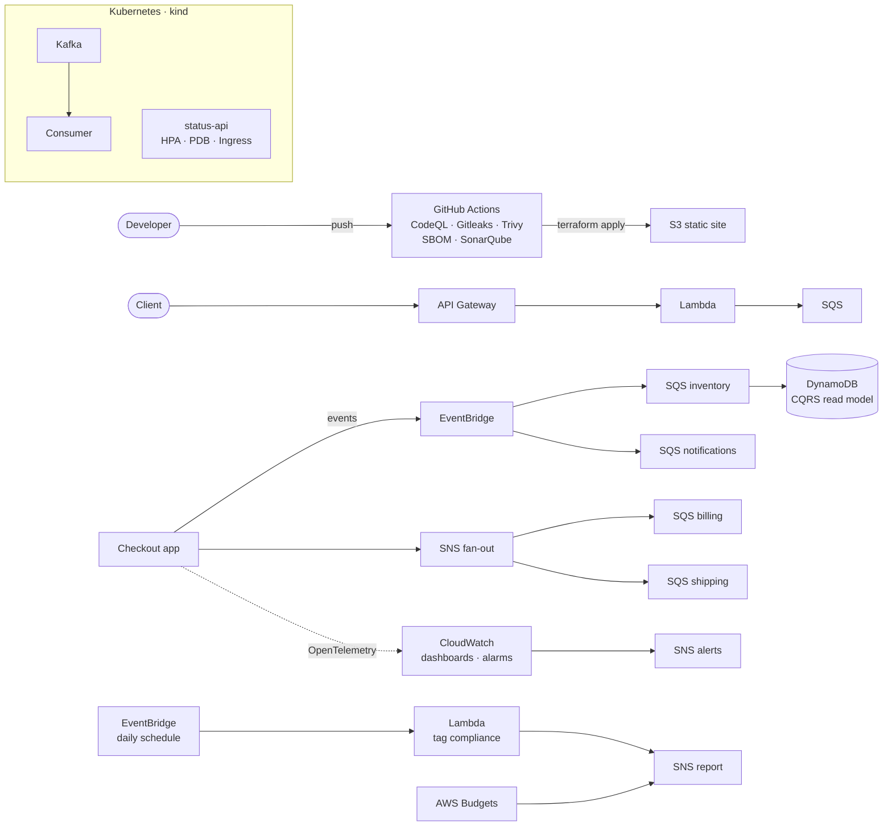

# cloud-devsecops-labs

> 18 progressive hands-on labs on AWS: a secure CI/CD pipeline, Infrastructure as Code, event-driven architecture, Kubernetes and FinOps, built on one evolving codebase.


---

## Table of contents
- [Overview](#overview)
- [Architecture](#architecture)
- [Labs](#labs)
- [Technical highlights](#technical-highlights)
- [Tech stack](#tech-stack)
- [Browse by lab](#browse-by-lab)
- [Getting started](#getting-started)
- [Cost & cleanup](#cost--cleanup)
- [Practices applied](#practices-applied)
- [Related project](#related-project)
- [Team & author](#team--author)
- [License](#license)

---

## Overview

This repository holds the full lab sequence of **Cloud Development II** (ESEN, 2026). The labs are cumulative: each one extends the same checkout application and its infrastructure instead of starting from scratch.

| Area | Labs | What it covers |
|---|---|---|
| **DevSecOps** | 1–4 | CI/CD with security and quality gates |
| **Infrastructure as Code** | 5–8 | Modular, multi-environment Terraform, remote state, observability |
| **Event-driven architecture** | 9–12 | EventBridge, SQS, SNS, DynamoDB, CQRS, Saga, API Gateway + Lambda |
| **Containers & Kubernetes** | 13–16 | kind, Kafka, probes, Ingress, autoscaling, Helm |
| **FinOps** | 17–18 | Cost analysis, budgets, automated tag governance |

The complete commit history is preserved with its original dates, and **every lab has a Git tag** with the exact state of the code at that point.

## Architecture



## Labs

| # | Topic | Key services & tools | Tag |
|---|---|---|---|
| 01 | Repository setup and base checkout app | Node.js, Jest | [`lab-01`](../../tree/lab-01) |
| 02 | Infrastructure as Code | Terraform, S3 static website | [`lab-02`](../../tree/lab-02) |
| 03 | CI/CD deployment pipeline | GitHub Actions, Terraform | [`lab-03`](../../tree/lab-03) |
| 04 | Security & quality gates | CodeQL, Gitleaks, Trivy, SBOM, SonarQube | [`lab-04`](../../tree/lab-04) |
| 05 | Modular Terraform | Terraform modules (`static-site`) | [`lab-05`](../../tree/lab-05) |
| 06 | Multi-environment + remote state | Workspaces, S3 backend, DynamoDB locking | [`lab-06`](../../tree/lab-06) |
| 07 | Observability | OpenTelemetry, CloudWatch | [`lab-07`](../../tree/lab-07) |
| 08 | Monitoring & alerting | CloudWatch dashboards and alarms, SNS | [`lab-08`](../../tree/lab-08) |
| 09 | Event-driven architecture | EventBridge custom bus, SQS consumers | [`lab-09`](../../tree/lab-09) |
| 10 | CQRS & Saga with compensation | DynamoDB read model, orchestrated Saga | [`lab-10`](../../tree/lab-10) |
| 11 | Enterprise integration | API Gateway, Lambda, SQS | [`lab-11`](../../tree/lab-11) |
| 12 | Fan-out | SNS → SQS billing / shipping | [`lab-12`](../../tree/lab-12) |
| 13 | Kubernetes & streaming | kind, Kafka producer/consumer, Service Discovery | [`lab-13`](../../tree/lab-13) |
| 14 | Production-ready containers | Multi-stage Docker, probes, Ingress NGINX | [`lab-14`](../../tree/lab-14) |
| 15 | Resilience & autoscaling | HPA, PodDisruptionBudget, rolling update | [`lab-15`](../../tree/lab-15) |
| 16 | Packaging | Helm chart (dev / prod), upgrade and rollback | [`lab-16`](../../tree/lab-16) |
| 17 | FinOps: Inform & Optimize | Python (pandas) cost analysis, AWS Budgets | [`lab-17`](../../tree/lab-17) |
| 18 | FinOps: Operate | Scheduled Lambda tag-compliance checker, EventBridge, SNS, Cost Anomaly Detection, Well-Architected review | [`lab-18`](../../tree/lab-18) |
| 19–20 | Application modernization | Strangler Fig pattern | [enterprise-app-modernization](https://github.com/JhonnatanPenate/enterprise-app-modernization) |

## Technical highlights

- **Security shift-left:** the pipeline runs static analysis (CodeQL), secret detection (Gitleaks), vulnerability scanning (Trivy), SBOM generation and a SonarQube quality gate before any deployment. A test commit with a fake secret was blocked on purpose (Lab 4).
- **Production-style Terraform:** reusable modules, dev/prod workspaces and remote state in S3 with DynamoDB locking.
- **Distributed transactions:** a Saga with compensating actions and a CQRS read model on DynamoDB, connected through EventBridge and SQS.
- **Resilient Kubernetes workloads:** liveness/readiness probes, Ingress, HPA, PodDisruptionBudgets and Helm releases per environment.
- **Automated cost governance:** a daily Lambda audits S3 buckets for the `CostCenter` and `Environment` tags and reports through SNS, alongside AWS Budgets and Cost Anomaly Detection.

## Tech stack

| Category | Tools |
|---|---|
| Cloud | AWS: S3, Lambda, API Gateway, EventBridge, SQS, SNS, DynamoDB, CloudWatch, IAM, Budgets, Cost Anomaly Detection |
| IaC | Terraform |
| CI/CD & security | GitHub Actions, CodeQL, Gitleaks, Trivy, SonarQube |
| Containers | Docker, Kubernetes (kind), Helm, Kafka |
| Observability | OpenTelemetry, CloudWatch |
| Languages | Node.js (AWS SDK v3, Jest), Python (pandas) |

## Browse by lab

Each tag points to the last commit of its lab.

```bash
git clone https://github.com/JhonnatanPenate/cloud-devsecops-labs.git
cd cloud-devsecops-labs
git checkout lab-10     # code exactly as it was at the end of Lab 10
git checkout main       # back to the latest state
```

On GitHub: **Tags → `lab-XX` → Browse files**.

## Getting started

### Prerequisites
- An AWS account with an IAM user configured through the AWS CLI. Credentials are **never** stored in this repository.
- Terraform 1.5+
- Node.js 18+ and npm
- Docker, kind, kubectl and Helm (Labs 13–16)
- Python 3 with pandas (Lab 17)

### Typical workflow for an AWS lab
```bash
terraform init
terraform apply      # deploy
# run the lab scripts / tests
terraform destroy    # always clean up
```

Run the unit tests:
```bash
npm install
npm test
```

Scripts that reference AWS resources use the placeholder `AWS_ACCOUNT_ID`; replace it with your own account ID.

## Cost & cleanup

Every AWS lab ends with `terraform destroy`, and the FinOps labs keep a monthly budget with alerts. The total accumulated cost of the course stayed at approximately **$0**.

## Practices applied

- Least-privilege IAM roles for every Lambda function
- No secrets or Terraform state in version control
- Mandatory `CostCenter` / `Environment` tagging
- Observability by default: traces, metrics, dashboards and alarms
- One tag per lab, Conventional Commits and preserved history

## Related project

**[enterprise-app-modernization](https://github.com/JhonnatanPenate/enterprise-app-modernization)** (Labs 19–20): incremental migration of a checkout monolith to microservices with the Strangler Fig pattern.

## Team & author

Built for **Cloud Development II**, ESEN (El Salvador), 2026.

**Team:** Susana Beltrán · Debbie Cruz · Andre Iraheta · Tiffany Meléndez · Dana Ochoa · Jhonnatan Peñate

This repository is my consolidated implementation: full commit history, one tag per lab, documentation and architecture diagrams.

**Maintainer:** Jhonnatan Peñate Serrano · [GitHub](https://github.com/JhonnatanPenate) · [LinkedIn](https://www.linkedin.com/in/jhonnatan-penate)

## License

Distributed under the MIT License. See [`LICENSE`](LICENSE).
