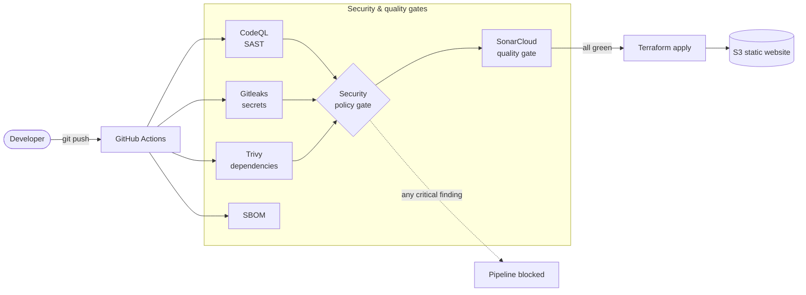

# DevSecOps pipeline · Labs 1–4

← [Back to the README](../../README.md)

Deployment depends on every security job, so a single critical finding stops the release. Labs: [1](../labs/lab-01.md) · [2](../labs/lab-02.md) · [3](../labs/lab-03.md) · [4](../labs/lab-04.md)
