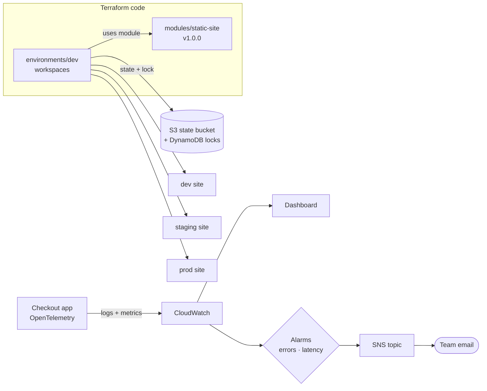

# Infrastructure as Code & observability · Labs 5–8

← [Back to the README](../../README.md)

Labs: [5](../labs/lab-05.md) · [6](../labs/lab-06.md) · [7](../labs/lab-07.md) · [8](../labs/lab-08.md)
